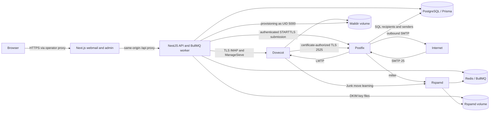

# FreeMailo architecture

Implementation review: 2026-11-21. This document describes the current single-host Compose application. The original eight-phase brief is the target, not evidence that every feature or production control is complete. See [application-review.md](application-review.md) for acceptance results and gaps.

## Components and data flow

There are seven long-running services and an optional migration container. Roundcube is not deployed. PostgreSQL stores domains, mailboxes, aliases, admin users, refresh tokens, contacts, labels, signatures, trusted senders, vacation settings, audit logs and provisioning jobs. Messages and attachments remain MIME files in Maildir; PostgreSQL is not the message store. The authoritative schema and migrations are in `prisma/`.

## Authentication and API

Mailbox login checks credentials through Dovecot; administrators use Argon2 database credentials. The API uses a required Dovecot master credential for subsequent user-scoped IMAP, SMTP and ManageSieve operations. Treat that credential and the API's access to the mail volumes as privileged.

Browser sessions use HttpOnly, SameSite=Strict access and refresh cookies, secure in production. Access tokens default to 15 minutes and refresh tokens to seven days. Refresh rotation consumes a token transactionally; concurrent use has one winner. The browser refreshes through a single shared request and does not retain a readable JWT. Unsafe cookie requests require the application header and an allowed origin; authenticated API clients can use Bearer tokens. Account/domain status is checked during authentication and authorization. Password changes revoke refresh sessions; already-issued access tokens have their existing bounded lifetime.

Swagger at `/api/docs` describes the running routes and DTOs. [api-specification.yaml](api-specification.yaml) is a generated snapshot. Request validation uses class-validator; Prisma handles application database access. SQL maps supply daemon lookup queries. API errors redact infrastructure details and carry request IDs. HTTP metrics label route templates, not individual message IDs.

## Mail operations

Message pagination uses Dovecot UID SORT across the entire selected folder before fetching one page. Search uses server-side IMAP SEARCH, including address, date, subject, text and attachment filtering. The ImapFlow version is pinned because its SORT adapter uses a private protocol interface. Folder metadata is briefly cached; there is no general persistent message-list cache.

Message detail parses MIME and sanitizes HTML with DOMPurify. The browser displays it in a sandboxed iframe with a restrictive content policy and remote-image consent. Authentication badges accept only the local receiving hostname, and Rspamd replaces incoming Authentication-Results headers on local, authenticated and inbound SMTP paths. These headers describe authentication checks, not whether a message is safe.

Sending validates recipients and attachment limits, submits through Postfix, and attempts an IMAP APPEND to Sent. A Sent-copy failure after SMTP acceptance is reported separately to avoid encouraging duplicate sends. Draft replacement appends before deleting the previous draft. Browser draft attachments are currently held in memory rather than saved in the server draft.

Realtime updates use bounded IMAP IDLE connections and Server-Sent Events, with heartbeat, reconnect, expiry and teardown handling. Thread retrieval exists in the API with a bounded result size; the reading pane still opens individual messages.

## Provisioning and storage

The worker runs with UID/GID 5000, writes validated paths on shared volumes, and has no Docker socket or shell provisioning dependency. Jobs are durable in PostgreSQL and dispatched through BullMQ. A reconciler repairs missing queue entries; retries use backoff and exhausted jobs remain visible for manual retry. Mailbox deletion disables access and archives retained mail under `.deleted/<mailbox-id>`.

DKIM keys are generated once per domain, reused on retries and stored in the Rspamd volume. Private keys are not returned through the API. Dovecot SQL is authoritative for passwords, quotas and account availability. Admin storage usage reads bounded Maildir quota counters and reports unavailable rather than invented values.

Persist PostgreSQL, Redis, Maildir, Rspamd/DKIM and the Postfix spool. Redis uses AOF and noeviction. Format-3 backups pause mail/API/Redis writers, dump SQL, archive all four non-SQL stores and write checksums. Isolated restoration validates SQL and archive bytes without touching the live deployment. TLS certificates, deployment secrets, DNS and host configuration need separate protected recovery copies.

## Network and runtime boundaries

| Endpoint | Compose exposure |
| --- | --- |
| SMTP 25, submission 465/587 | Public host ports; AUTH disabled on 25; submission requires TLS and sender ownership |
| IMAP 993, ManageSieve 4190 | Public host ports; TLS/STARTTLS required for credentials |
| Sieve submission 2525 | Docker mail network only; pinned client certificate required |
| Web 3000 | Published; production must put an HTTPS proxy in front and restrict direct access |
| API 4000, Rspamd controller 11334 | Host loopback only; restrict proxy routing to administrative/monitoring endpoints |
| PostgreSQL, Redis, LMTP and auth listener | Internal; development override adds loopback debugging ports |

Compose networks are bridge networks, not an isolation boundary against a compromised host. API/web run as non-root; mail daemons need privileged startup before dropping worker privileges. Internal IMAP/SMTP/ManageSieve connections validate TLS in production. Database, Redis, LMTP and milter traffic use private Docker networks. Configure the host firewall, external alerts, proxy trust and daemon brute-force controls separately; they are not installed by this repository.
