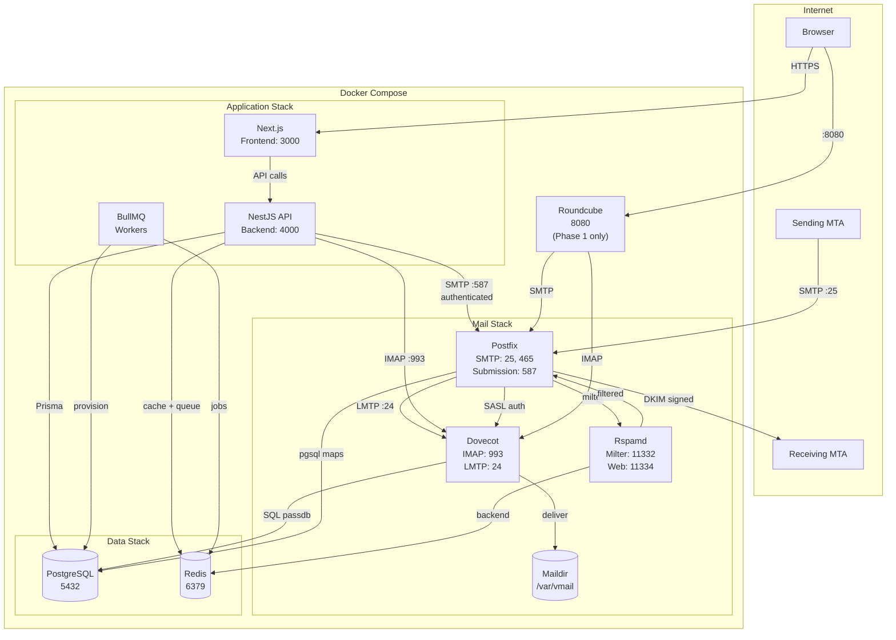
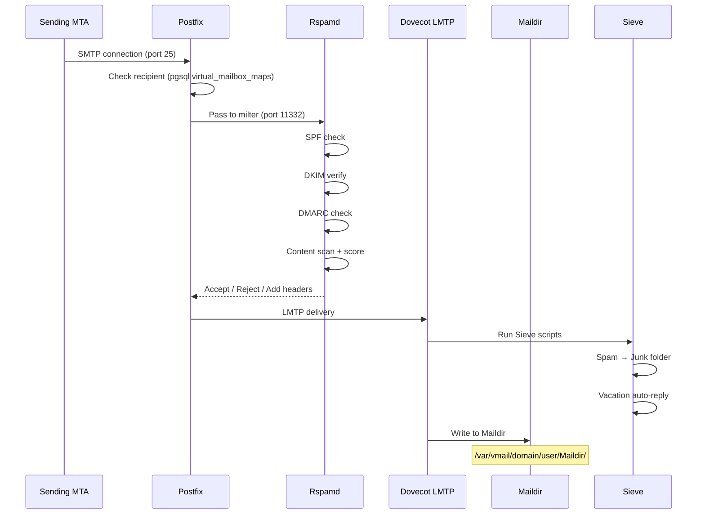
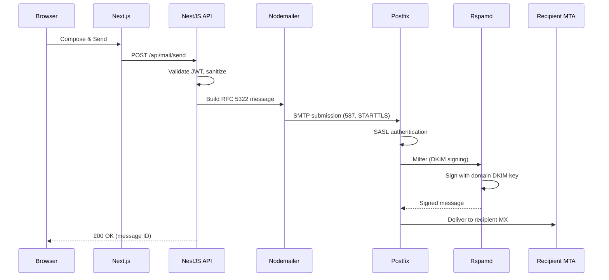
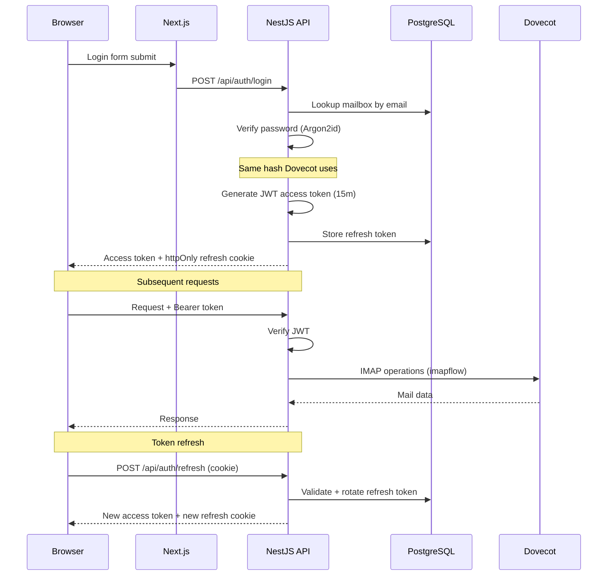
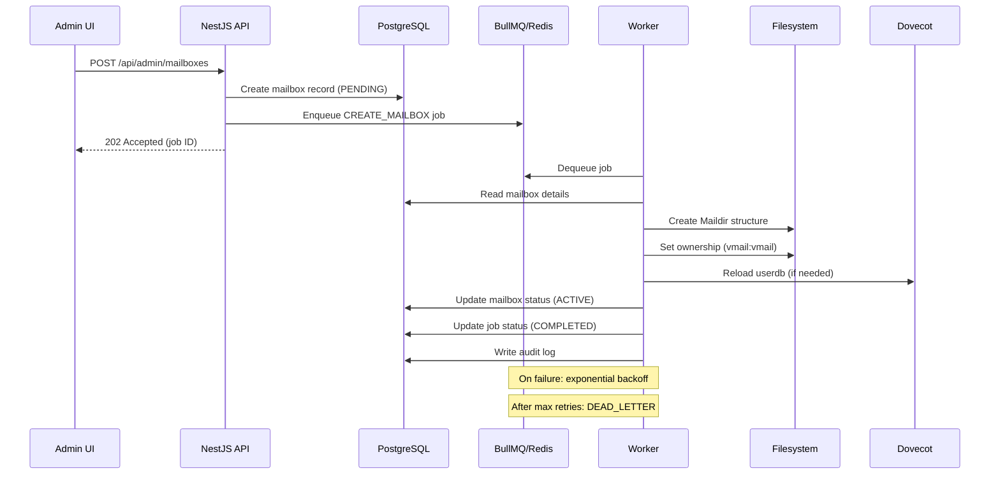
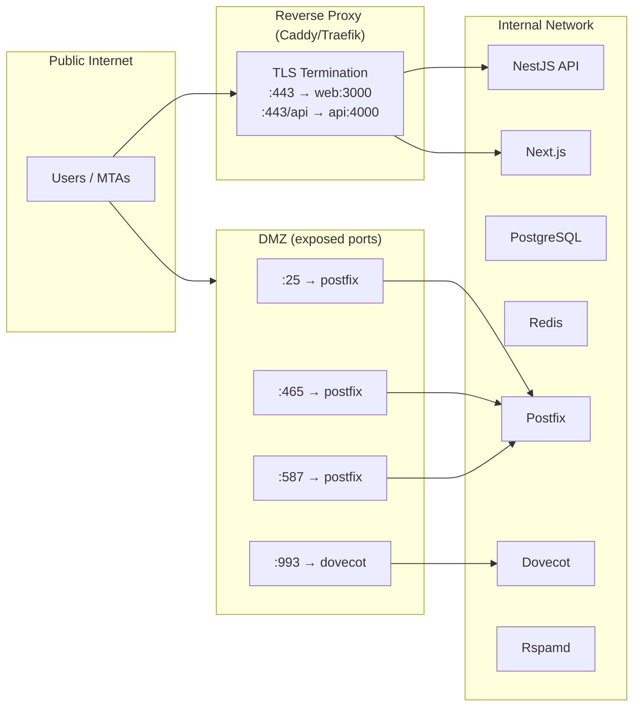

# MailHive — Architecture Document

## 1. System Overview

MailHive is a self-hosted, multi-domain email hosting platform that combines a full production mail stack (Postfix, Dovecot, Rspamd) with a Gmail-style webmail UI built on Next.js and NestJS. All virtual domains and users are managed in PostgreSQL via Prisma. The browser never speaks IMAP directly — the NestJS backend proxies all mail operations. Everything runs in Docker Compose with separate production and development configurations.

## 2. Architecture Diagram



## 3. Component Details

### 3.1 Postfix (MTA)

| Setting | Value |
|---------|-------|
| Role | SMTP relay (inbound/outbound) |
| Ports | 25 (SMTP), 465 (SMTPS), 587 (submission) |
| Virtual domains | `pgsql:/etc/postfix/pgsql-virtual-domains.cf` |
| Virtual mailboxes | `pgsql:/etc/postfix/pgsql-virtual-mailboxes.cf` |
| Virtual aliases | `pgsql:/etc/postfix/pgsql-virtual-aliases.cf` |
| TLS | Opportunistic inbound, mandatory on submission |
| SASL | Via Dovecot (`/var/spool/postfix/private/auth`) |
| Milter | Rspamd on `inet:rspamd:11332` |
| Rate limiting | `smtpd_client_message_rate_limit = 100` |
| Message size | `message_size_limit = 26214400` (25MB) |
| Relay restrictions | `permit_mynetworks, permit_sasl_authenticated, reject_unauth_destination` |

Key configuration files:
- `main.cf` — Global settings, virtual maps, TLS, milter
- `master.cf` — Service definitions (smtp, submission, smtps)
- `pgsql-virtual-*.cf` — PostgreSQL lookup maps

### 3.2 Dovecot (IMAP / LMTP / Auth)

| Setting | Value |
|---------|-------|
| Protocols | IMAP, LMTP, Sieve, ManageSieve |
| IMAP port | 993 (TLS only) |
| LMTP | Unix socket or port 24 |
| Maildir | `/var/vmail/%d/%n/Maildir` |
| Auth | SQL passdb/userdb against PostgreSQL |
| Password scheme | `{ARGON2ID}` or `{BLF-CRYPT}` |
| Quota | `quota = maildir:User quota` with SQL lookup |
| Sieve | Global + per-user scripts, ManageSieve on 4190 |
| TLS | 1.2+ only, `ssl_prefer_server_ciphers = yes` |
| Logging | `auth_verbose = yes`, fail2ban-friendly format |

Auth flow: Postfix delegates SASL to Dovecot via a Unix socket. Dovecot queries PostgreSQL for `password_hash` and `is_active` status.

### 3.3 Rspamd (Spam / Phishing Filter)

| Feature | Config |
|---------|--------|
| Integration | Postfix milter on port 11332 |
| Greylisting | Enabled, Redis backend |
| DKIM signing | Per-domain keys, selector from DB |
| SPF/DKIM/DMARC | Inbound verification |
| Redis | Shared backend for bayes, rate limits, greylisting |
| Web UI | Port 11334, behind admin auth |
| Spam action | Reject at score ≥ 15, add header at ≥ 6 |
| Sieve rule | Move `X-Spam: Yes` to Junk folder |

### 3.4 PostgreSQL

Source of truth for all configuration data:
- Domains (with DNS verification status)
- Mailboxes (credentials, quotas)
- Aliases and forwarding rules
- Admin users
- DKIM keys
- Provision jobs
- Audit logs
- User settings (labels, signatures, contacts)

Accessed by:
- NestJS via Prisma ORM (primary)
- Postfix via `pgsql:` lookup maps (read-only, specific queries)
- Dovecot via SQL passdb/userdb (read-only, auth queries)

### 3.5 Redis

Three distinct uses:
1. **BullMQ** — Job queue for provisioning (create domain, mailbox, etc.)
2. **Cache** — Folder lists, message list metadata, session data (TTL-based)
3. **Rspamd** — Bayes classifier, greylisting, rate limits

Never caches message bodies beyond session scope.

### 3.6 NestJS API Backend

| Module | Responsibility |
|--------|---------------|
| `AuthModule` | JWT access/refresh tokens, Dovecot credential validation |
| `AdminModule` | Domain/mailbox/alias CRUD, DNS verification |
| `MailModule` | IMAP proxy (imapflow), message operations |
| `SendModule` | Outbound mail via nodemailer → Postfix submission |
| `ProvisionModule` | BullMQ job processing with exponential backoff |
| `SearchModule` | IMAP SEARCH/SORT translation |
| `RealtimeModule` | IMAP IDLE → SSE/WebSocket relay |
| `SettingsModule` | User preferences, signatures, vacation |

Key libraries:
- `imapflow` — IMAP client for Dovecot
- `nodemailer` — SMTP client for Postfix
- `mailparser` — RFC 5322 message parsing
- `@nestjs/bull` — BullMQ integration
- `argon2` — Password hashing

### 3.7 Next.js Frontend

- **App Router** with server components and client components
- **Tailwind CSS + shadcn/ui** for Gmail-style components
- **TipTap** rich text editor for compose
- **DOMPurify** for HTML email sanitization
- **Light/Dark themes** with CSS variables
- **Responsive** — desktop sidebar, tablet/mobile drawer
- **Keyboard shortcuts** — Gmail-compatible bindings
- **SSE client** — Real-time new mail notifications

### 3.8 Roundcube (Phase 1 Only)

Temporary webmail client for Phase 1 acceptance testing. Connects directly to Dovecot IMAP and Postfix SMTP. Removed in Phase 6 when the custom UI reaches parity.

## 4. Mail Flow Diagrams

### 4.1 Inbound Mail



### 4.2 Outbound Mail



### 4.3 Authentication Flow



### 4.4 Mailbox Provisioning



## 5. Docker Compose Service Map

| Service | Image | Ports (Host:Container) | Volumes | Depends On |
|---------|-------|----------------------|---------|------------|
| `postgres` | `postgres:16-alpine` | `5432:5432` | `pgdata:/var/lib/postgresql/data` | — |
| `redis` | `redis:7-alpine` | `6379:6379` | `redisdata:/data` | — |
| `postfix` | `custom` (./docker/postfix) | `25:25`, `465:465`, `587:587` | `vmail:/var/vmail`, `certs:/etc/ssl/mail` | postgres, redis |
| `dovecot` | `custom` (./docker/dovecot) | `993:993`, `4190:4190` | `vmail:/var/vmail`, `certs:/etc/ssl/mail` | postgres |
| `rspamd` | `custom` (./docker/rspamd) | `11334:11334` | `rspamddata:/var/lib/rspamd` | redis |
| `api` | `custom` (./apps/api) | `4000:4000` | — | postgres, redis, dovecot, postfix |
| `web` | `custom` (./apps/web) | `3000:3000` | — | api |
| `roundcube` | `roundcube/roundcubemail` | `8080:80` | — | dovecot, postfix |

### Docker Networks

| Network | Purpose | Members |
|---------|---------|---------|
| `mailnet` | Mail infrastructure | postfix, dovecot, rspamd, redis |
| `appnet` | Application layer | api, web, postgres, redis |
| `frontend` | Public-facing | web, roundcube |

All services on `mailnet` and `appnet` are internal. Only `frontend` services expose ports to the host.

### Volumes

| Volume | Purpose | Backup Required |
|--------|---------|----------------|
| `pgdata` | PostgreSQL data | ✅ Critical |
| `redisdata` | Redis persistence | ⚠️ Recommended |
| `vmail` | Maildir storage | ✅ Critical |
| `certs` | TLS certificates | ✅ Critical |
| `rspamddata` | Rspamd learned data | ⚠️ Recommended |

## 6. Security Architecture

### 6.1 TLS

- **Inbound SMTP (25)**: Opportunistic TLS (STARTTLS offered, not required)
- **Submission (587)**: Mandatory STARTTLS
- **SMTPS (465)**: Implicit TLS
- **IMAP (993)**: Implicit TLS
- **HTTPS (443)**: TLS 1.2+ via reverse proxy
- **Internal**: Services communicate over Docker network (no TLS between containers)

Certificate management: Let's Encrypt via certbot with auto-renewal and reload hooks for Postfix/Dovecot.

### 6.2 Authentication

```
                    ┌─────────────┐
                    │   Browser   │
                    └──────┬──────┘
                           │ JWT Bearer
                    ┌──────▼──────┐
                    │  NestJS API │
                    │             │
                    │ JWT verify  │
                    │ Rate limit  │
                    │ CORS check  │
                    └──────┬──────┘
                           │
              ┌────────────┼────────────┐
              ▼            ▼            ▼
        ┌──────────┐ ┌──────────┐ ┌──────────┐
        │PostgreSQL│ │ Dovecot  │ │ Postfix  │
        │ (Prisma) │ │  (IMAP)  │ │ (SMTP)   │
        └──────────┘ └──────────┘ └──────────┘
```

- **JWT Access Token**: 15-minute expiry, in `Authorization` header
- **Refresh Token**: 7-day expiry, `httpOnly`, `secure`, `SameSite=strict` cookie
- **Token rotation**: Each refresh invalidates the old token and issues a new pair
- **Admin vs Mailbox**: Separate JWT claims and role-based guards
- **Password hashing**: Argon2id (compatible with Dovecot `{ARGON2ID}` scheme)

### 6.3 Email Security in UI

- HTML email sanitized server-side with DOMPurify (remove scripts, event handlers, dangerous tags)
- Rendered in sandboxed `<iframe>` with strict CSP: `sandbox allow-same-origin`
- Remote images blocked by default; "Display images" button with trusted-sender persistence
- Link inspection: show real URL on hover, warn on mismatched display text vs href
- SPF/DKIM/DMARC badge from `Authentication-Results` header

### 6.4 API Security

- Input validation with `class-validator` and `zod`
- Rate limiting per endpoint (login: 5/min, API: 100/min, send: 20/min)
- CORS: allow only `APP_URL` origin
- Helmet for HTTP security headers
- CSRF protection for state-changing requests
- SQL injection: Prisma parameterized queries; Postfix/Dovecot SQL maps use `%s` parameter binding

### 6.5 Container Security

- All containers run as non-root (except Postfix which needs port 25)
- Read-only filesystem where possible
- No `privileged` flag
- Secrets via environment variables or Docker secrets (never in images)
- Regular dependency audits (`npm audit`, `trivy` image scan)

## 7. Network Architecture



Only ports 25, 465, 587, 993, and 443 are exposed to the internet. All other inter-service communication happens on internal Docker networks.
