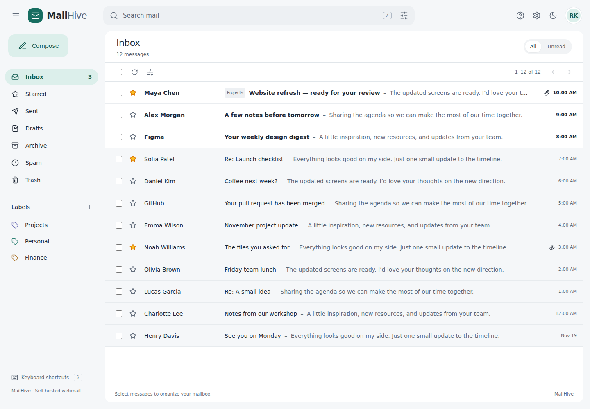

# Phase 4 UI review — 20 November 2026

> UI follow-up: [signup and admin consistency review — 24 November 2026](signup-admin-ui-review.md).

> Follow-up: the backend failure and several integration gaps below were addressed in the [application revision](application-review.md). This document records the earlier UI-only review.

FreeMailo now has a Gmail-inspired mailbox layout with its own teal identity, persistent light/dark theme, collapsible sidebar, mobile navigation drawer, compact/comfortable rows, clear unread and selected states, and responsive reading and compose views. The work follows the repository's `ui-ux-pro-max` and `ui-styling` skills.



[Dark theme](ui-review/inbox-dark.png) · [Mobile](ui-review/inbox-mobile.png) · [Compose](ui-review/compose.png) · [Reading view](ui-review/reading.png)

## What changed

- Normalized `/auth/me`: the existing API returns a user directly, while the old frontend expected `{ user }`. This mismatch prevented the authenticated mailbox from loading.
- Rebuilt the shell, folder navigation, search, account menu, message list, reading pane, compose panel, and modal presentation. Radix dialogs and menus provide dismissal, focus management, and keyboard behavior. All controls have names and visible focus states.
- Added retryable errors, offline feedback, loading skeletons, unread filtering, selection, move and label actions, and pagination that ignores stale responses after folder changes.
- Fixed actions from Starred/search to use their backing INBOX folder. Labels use stable IMAP keywords (`FreeMailo_<label id>`), remain assigned after renames, and can be created, renamed, recolored, deleted, applied, and searched. The UI resolves label names to IDs; the API now exposes those IDs in list/search responses and searches the keyword.
- Implemented the advertised `j/k`, `r/a/f`, and `g i` shortcuts alongside compose/search/star/archive/delete/help. Shortcuts do not run while typing or using an overlay.
- Replaced the plain textarea with [TipTap](https://tiptap.dev/docs/editor/getting-started/install/react): bold, italic, underline, lists, links, undo, signature insertion, contact suggestions, Cc/Bcc, attachment selection/drop, and minimize/maximize controls.
- Serialized draft saves, saved on close, implemented discard, and reopened Drafts messages in the editor using their existing UID. New compose sessions start clean. Failed saves keep the editor open. Attachments remain in the open/minimized editor until sending because the current draft endpoint does not persist files.
- Corrected reply-all recipients and forwarding (empty To field plus quoted content). Added client-side DOMPurify, restrictive iframe CSP, default remote-image blocking, trusted sender handling, link destination titles/warnings, SPF/DKIM/DMARC badges, and authenticated downloads with the correct folder.
- Deferred the editor bundle until Compose opens: production inbox first-load JavaScript is **158 kB**, compared with **293 kB** before deferring the newly added editor.

## Verification

Commands ran from the indicated directory against the production frontend on port 3001.

| Directory | Command | Result |
| --- | --- | --- |
| `apps/web` | `npm run typecheck` | Passed |
| `apps/web` | `npm run lint` | Passed; four pre-existing hook dependency warnings in admin pages |
| `apps/web` | `API_URL=http://127.0.0.1:4000 npm run build` | Passed; all 12 static pages generated |
| `apps/api` | `npm run build` | Passed |
| `apps/api` | `npm test -- --runInBand --watchman=false imap-labels.spec.ts` | 1 test passed: stable label keyword, unread filter, UID pagination, returned labels, connection cleanup |
| `apps/web` | `npm run test:e2e` with the selection below | **13 tests passed** in 24.1 s |
| Repository | `git diff --check` | Passed |

Exact browser verification command:

```sh
PLAYWRIGHT_BASE_URL=http://127.0.0.1:3001 npm run test:e2e -- e2e/redesign.spec.ts e2e/a11y.spec.ts e2e/webmail.spec.ts --grep-invert 'Flow 2|Flow 3' --workers=1
```

The eight new browser flows cover desktop/dark accessibility, keyboard navigation, reading sanitization and blocked remote images, rich compose/reply-all/forward, Starred actions and labels, mobile dialogs, error/retry/empty/offline states, draft lifecycle/resume, and stale pagination responses. Their API fixtures live only in the test file. Send and draft assertions are API-contract tests, not evidence of SMTP delivery.

The existing login, navigation, shortcuts, settings, and accessibility checks also passed against the running API. Existing real-send flows 2 and 3 were not included in this run.

**Lighthouse accessibility: 100/100**, measured on the final production build with a populated test mailbox. [Full HTML report](ui-review/lighthouse.html) · [Machine-readable summary](ui-review/lighthouse-summary.json). Axe found no WCAG 2.1 A/AA violations in the tested populated desktop light/dark, mobile, reading, compose, and settings states. These automated checks do not replace manual assistive-technology testing.

## Phase 4 gaps that remain

The original brief's entire phase 4 is not yet complete. The redesign does not certify the following existing gaps:

1. **Live IMAP access:** login succeeds, but the currently running API returns HTTP 500 for mailbox requests and logs `Connection not available`. The UI exposes a retryable error. Live inbox, delivery, and realtime acceptance need to be rerun once that service issue is resolved. The deployed containers have not been rebuilt with these changes.
2. **All Mail and cross-folder search:** the current API searches one folder. Global search, Starred, and label views currently use INBOX; there is no true aggregated All Mail view.
3. **Conversation grouping:** the frontend still reads individual messages. The backend thread method scans only the first 50 messages of INBOX and Sent, so it is not ready for complete conversations or expand-all behavior.
4. **Attachment features:** draft attachments are retained in the current compose window, not persisted to IMAP Drafts. Upload percentage, inline/CID image previews, and forwarding original attachments are not implemented.
5. **Search completeness:** `has:attachment` is not implemented by the backend and is not presented as a working advanced-search toggle. List snippets are currently empty in real API responses.
6. **Settings:** password-change and vacation-responder settings still need frontend integration; vacation delivery must be verified through ManageSieve, not just database storage.
7. **Dependencies:** `npm audit` still reports the existing Next.js/runtime PostCSS findings (one critical, one high). No TipTap finding was reported. The new lint tool's glob dependency is overridden to its patched release. A tested Next.js upgrade remains separate work.

## Preview and repeat the checks

The verified frontend is available at `http://127.0.0.1:3001`, connected to the existing API on port 4000. To start it again:

```sh
cd apps/web
API_URL=http://127.0.0.1:4000 npm run build
API_URL=http://127.0.0.1:4000 npm run start -- --hostname 127.0.0.1 --port 3001
```

Run `PLAYWRIGHT_BASE_URL=http://127.0.0.1:3001 npm run test:ui` for the eight isolated browser flows. Run the broader verification command above when the local test accounts/API are available. Fixture screenshots illustrate the UI; the production app never substitutes sample mail for API data.
